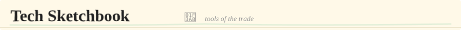
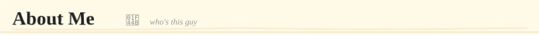

  

  &nbsp;
  &nbsp;
  &nbsp;
  

---

### 🚤 Software Lead &nbsp;·&nbsp; AUV Calgary

> **Sept 2025 → Present** &nbsp;·&nbsp; [auvucalgary.ca](https://auvucalgary.ca) &nbsp;·&nbsp; University of Calgary

Leading the software sub-team for a **founding-year autonomous underwater vehicle team**, building everything from scratch toward our first **RoboSub 2027** competition entry. Designed the ROS2 architecture, set up the Gazebo simulation environment, and shipped the team's public website.

- Designed the **ROS2 node architecture** — `auv_control` (thrust), `perception_mock` (object markers), camera bridging, and TF tree
- Built the **Gazebo simulation environment** with custom Tethys AUV model, RoboSub 2025 world, forward + downward cameras, and RViz integration
- Shipped the **team website** — React + Vite SPA with team profiles, vehicle page, blog, docs, media gallery, sponsors, and judges hub
- Leading a 5-person software sub-team across simulation, perception, and controls
- *founding team — built all software architecture decisions from zero, no handoff*

  
  
  
  
  
  

### 💪 Backend Developer &nbsp;·&nbsp; FITRA Gym

> **Oct 2026 → Present** &nbsp;·&nbsp; [fitragym.ca](https://fitragym.ca)

Building the **production backend** for a women's fitness centre booking system — Express + Prisma + PostgreSQL, replacing a 3,648-line localStorage prototype with a real server. Two portals (Community & School), four roles, 13 Prisma models.

- **Credit ledger** via SUM-delta pattern — no running balance to desync, atomic capacity enforcement
- **Waitlist offer chain** with 60-min reserve window, 4-day refund cutoff, FTR-XXXXX booking refs
- **Stripe Checkout** integration for drop-ins, memberships, and credit packs — all money in integer cents CAD
- JWT sessions via HttpOnly cookies, bcrypt 12-round hashing, Resend transactional email, audit log on all admin actions
- *one Express server hosts both the wave2 marketing site and the booking app at /app*

  
  
  
  
  
  

### 🕌 Software Developer &nbsp;·&nbsp; Khutba

> **May 2026 → Sep 2026** &nbsp;·&nbsp; [khutba.net](https://khutba.net) &nbsp;·&nbsp; SaaS Product

Built a **SaaS sermon planning platform** for mosque imams. Next.js + Prisma + PostgreSQL with session-based auth, role-based access, mosque invitations, and **18 API route groups**.

- Designed the **4-season × 16-slot annual plan model** with elastic sub-bouquets — structurally coherent yet flexible per imam's needs
- **Hijri occasion interleaving**: Eid, Ramadan, and special sermons auto-placed by date into the correct seasonal block
- Cross-season spillover, dual-delivery Eid stacking, moon-sighting ±1 day tolerance
- Mosque invite system, multi-imam collaboration, Stripe subscription billing (Personal/Team/Institution tiers)
- *designed the entire annual-plan data model from scratch — 64-slot elastic architecture*

  
  
  
  
  
  

### 🔁 Backend Developer &nbsp;·&nbsp; CycleBreaker

> **Jan 2026 → Apr 2026** &nbsp;·&nbsp; [cyclebreaker.net](https://cyclebreaker.net) &nbsp;·&nbsp; Education Platform

Built the Express + Prisma + PostgreSQL backend for a **science-based addiction recovery education platform** serving youth. JWT auth with silent refresh, role-based access, full admin CMS, and a **rule-based risk prediction engine**.

- Recovery tools: private journal with mood/craving/stress tracking, HALT indicators, daily check-ins
- **Rule-based risk prediction** — 7-day and 30-day trend aggregation, trigger frequency, risk scoring with suggested actions
- Full admin CMS: articles, courses with multi-lesson paths, videos, quizzes with scoring, resources, and 36-field homepage editor
- Email system: welcome, password reset, weekly recovery digest (personalized stats + new content)
- *deployed on Railway (backend) + Netlify (frontend) — live at cyclebreaker.net*

  
  
  
  
  
  

### ❤️ Full-Stack Developer &nbsp;·&nbsp; NikahNet

> **2025 → Present** &nbsp;·&nbsp; [nikahnet.net](https://nikahnet.net) &nbsp;·&nbsp; In Production

A Muslim community matrimonial platform **serving real users in production**. React + Vite frontend on Vercel, Express 5 + Prisma + PostgreSQL on Railway, Redis for rate limiting, Cloudflare R2 for photo storage, and Socket.IO for real-time messaging. **JWT auth built from the RFC — no Auth0, no shortcuts.**

- Migrated live database from SQLite to PostgreSQL — **zero data loss, zero downtime**
- CSRF protection, request IDs, graceful shutdown, Redis-backed rate limiting
- Multi-photo profiles (4/user via R2), compatibility scoring, admin verification flow
- Real-time messaging with Socket.IO + Redis adapter, anti-spam enforcement
- *solo-shipped the entire stack — frontend, backend, DB, deploy*

  
  
  
  
  
  
  
  

---

#### Languages

  
  
  
  
  
  
  
  

#### Frameworks

  
  
  
  
  
  
  
  

#### Databases & Cloud

  
  
  
  
  
  
  
  
  

#### Developer Tools

  
  
  
  
  
  
  
  
  
  
  
  

---

> **Backend systems. Security by default. Math brain.**

I'm a Math student at the University of Calgary who builds backend systems and SaaS products that ship to real users. I care about the engineering underneath — not just whether it runs, but whether it's **correct, maintainable, and ready to scale**.

*all 5 products are live in production — not localhost demos, not course assignments.*

Coming from pure mathematics, I think in systems and invariants. I ask *why* before I ask *how*. I've migrated a live production database without losing a single row, designed a 64-slot elastic data model for a SaaS sermon planner, built an atomic credit ledger and waitlist chain for a client gym booking system, and led a 5-person software team building ROS2 architecture from scratch — all as a student, all shipped, all live.

**proof-first. then code. always.**

<table>
  <tr>
    <td><strong>currently</strong></td>
    <td>Software Lead · AUV Calgary · University of Calgary</td>
  </tr>
  <tr>
    <td><strong>studying</strong></td>
    <td>Mathematics · University of Calgary</td>
  </tr>
  <tr>
    <td><strong>shipped</strong></td>
    <td>5 products live in production — <a href="https://nikahnet.net">nikahnet.net</a> · <a href="https://khutba.net">khutba.net</a> · <a href="https://fitragym.ca">fitragym.ca</a> · <a href="https://cyclebreaker.net">cyclebreaker.net</a> · <a href="https://auvucalgary.ca">auvucalgary.ca</a></td>
  </tr>
  <tr>
    <td><strong>stack</strong></td>
    <td>Express · Prisma · PG · JWT · Stripe · Redis · Socket.IO · ROS2</td>
  </tr>
  <tr>
    <td><strong>team led</strong></td>
    <td>5 engineers — ROS2, Gazebo sim, perception & control</td>
  </tr>
  <tr>
    <td><strong>based in</strong></td>
    <td>Calgary 🇨🇦 · open to remote</td>
  </tr>
</table>

 

> *Security isn't a feature* — I implement auth correctly regardless of what the app is. Refresh token rotation, rate-limited endpoints, input validation — these are engineering defaults. I read the RFC before I write the implementation. **no Auth0. no shortcuts. just understanding.**

> *Systems before syntax* — Pure math trained me to model a system completely before touching the keyboard. Prisma schemas, credit ledgers, elastic data models — I architect for correctness first. **invariants first. implementation second.**

> *Internals over abstractions* — I read docs and source code. Shipping to real users taught me what no textbook could — edge cases at 2am, schema gaps you only see under load, the difference between *working* and *correct*. **why before how. always.**

---

  

  &nbsp;
  &nbsp;
  &nbsp;
  

